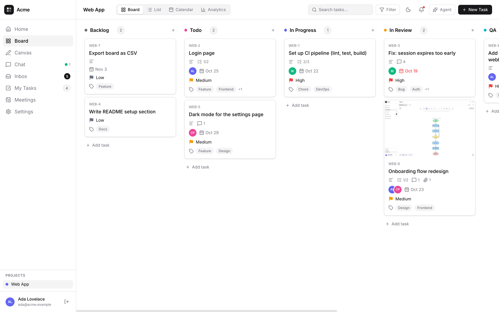
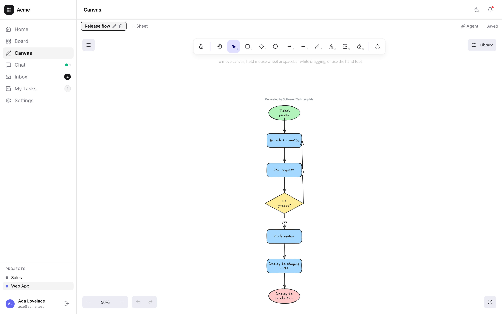
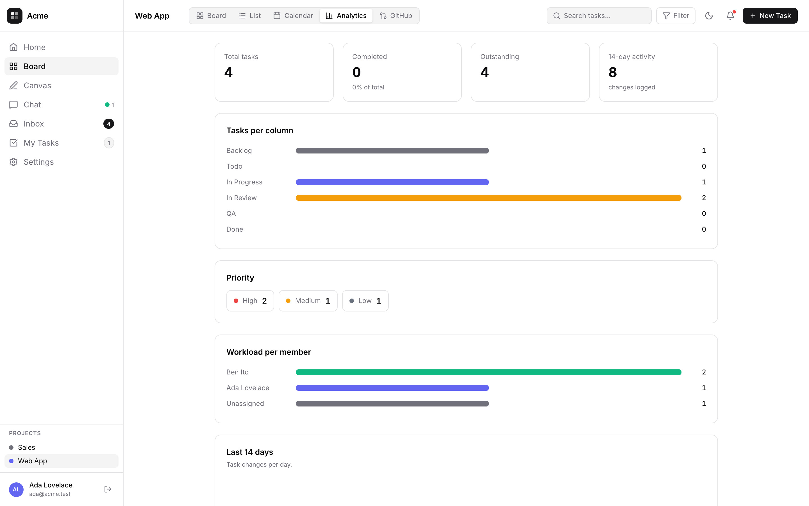
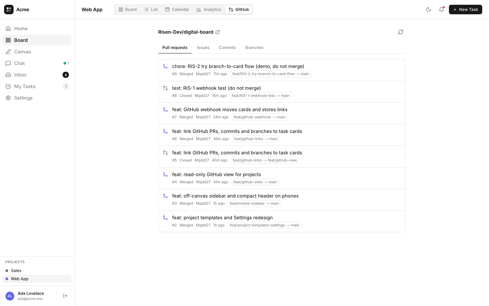
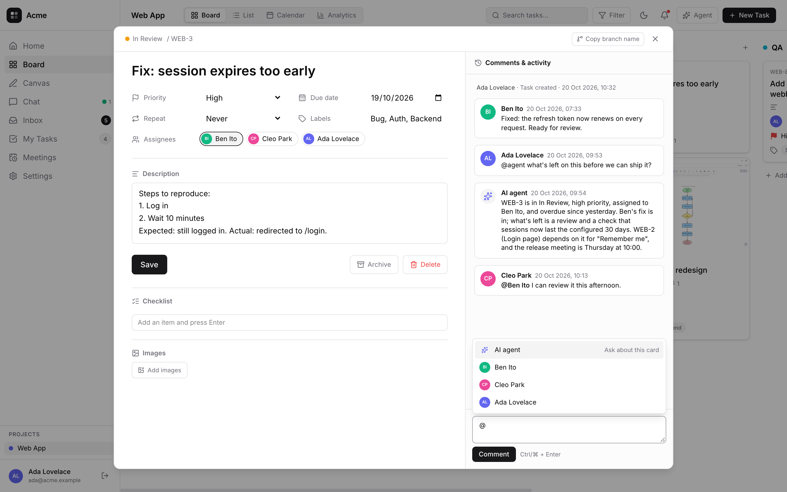
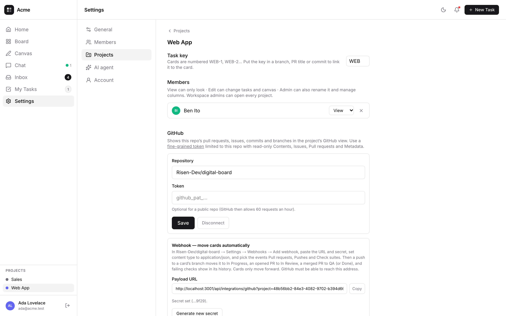
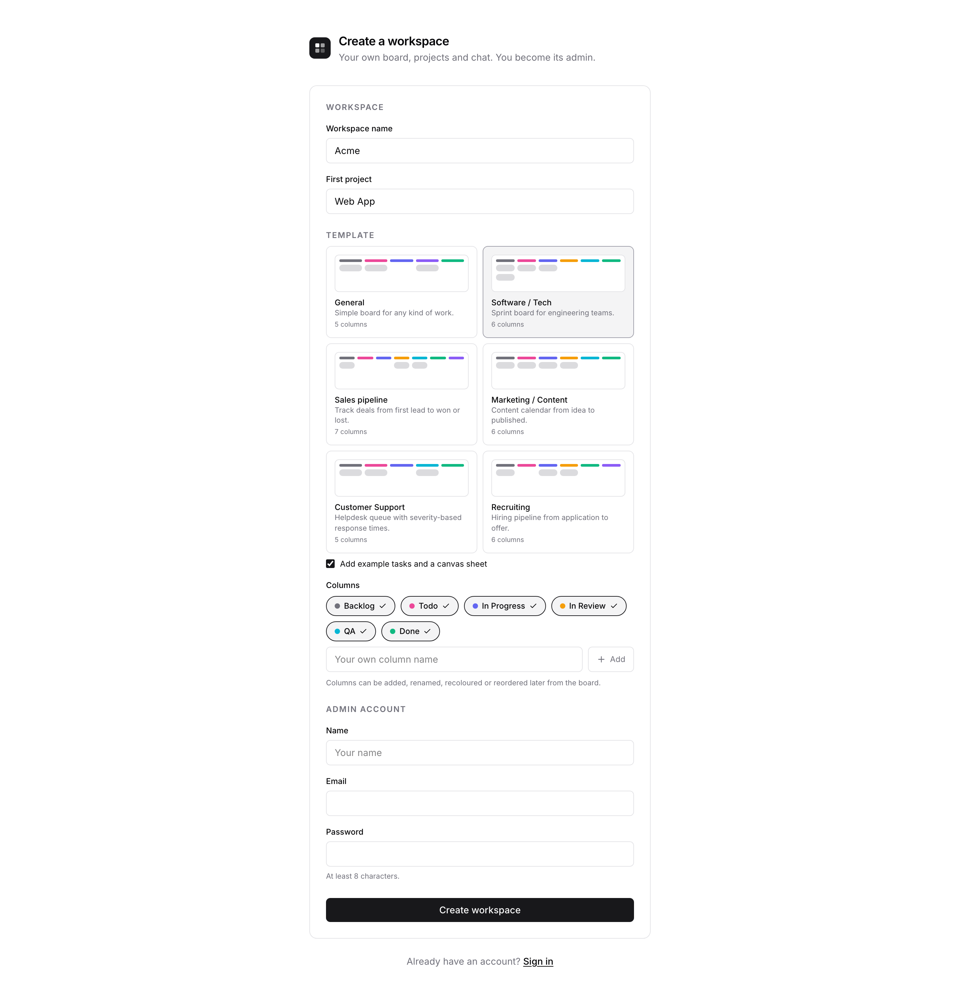

# Digital Board

[](LICENSE)
[](https://nodejs.org)
[](https://www.postgresql.org)

Self-hosted work tracker. A kanban board with List, Calendar and Analytics views
over the same tasks, project templates for engineering, sales, marketing,
support and hiring, a GitHub integration that moves cards as branches and pull
requests progress, an inbound webhook and email-to-ticket for creating cards
from other tools, an iCal feed for calendar apps, a free-form drawing canvas
with multiple sheets, and workspace chat with direct messages. Multi-user,
with per-project roles.
Runs on your own machine against your own PostgreSQL — no per-seat billing.



<table>
  <tr>
    <td width="50%"><br><sub><b>Canvas</b> — Excalidraw sheets per project</sub></td>
    <td width="50%"><br><sub><b>Analytics</b> — column, priority, workload, 14-day activity</sub></td>
  </tr>
  <tr>
    <td><br><sub><b>GitHub</b> — the repo's PRs, issues, commits and branches</sub></td>
    <td><br><sub><b>Task</b> — properties on the left; comments, an @agent answer and the @ picker on the right</sub></td>
  </tr>
  <tr>
    <td><br><sub><b>Chat</b> — workspace channel and direct messages</sub></td>
    <td><br><sub><b>Settings</b> — members, projects, GitHub, AI agent, account</sub></td>
  </tr>
</table>

## Quick start

```bash
sudo -u postgres psql <<'SQL'
CREATE ROLE board LOGIN PASSWORD 'choose-something';
CREATE DATABASE board OWNER board;
SQL

git clone https://github.com/Risen-Dev/digital-board.git
cd digital-board
npm install

cp .env.example .env      # set DATABASE_URL
npm run build
npm start
```

Open <http://localhost:3000> and choose **Create a workspace** (`/register`) — it asks
for the workspace name, your first project, a template (General, Software / Tech,
Sales, Marketing, Support or Recruiting — each sets the columns, optionally with
example tasks and a canvas sheet) and the admin account.
Anyone can register a workspace of their own; set `REGISTRATION_CLOSED=1` to stop that.


 Tables create themselves on first use; there is no migration
command.

Requires **Node 22+** and **PostgreSQL 14+** (verified on 16). For development,
`npm run dev`.

## Features

| Area | |
|---|---|
| **Board** | Drag and drop with reordering inside a column and positional drops between columns. Mouse, touch and keyboard. Cards show a cover image, the title, icons for details/checklist/comments/images/repeat, assignees and due date (red once overdue), a priority flag and labels. Click the workspace name in the sidebar or Settings, or the project title in the header or Settings, to rename it. Columns are add / rename / recolour / reorder / delete. |
| **List, Calendar, Analytics** | The same tasks as a table, on a month grid by due date, and as charts — column distribution, priority split, workload per member, 14-day activity. |
| **Task dialog** | Properties on the left (priority, due date, repeat, labels, assignees), then the description, checklist, images (the first is the card's cover) and GitHub links; comments and activity on the right. Typing `@` in a comment lists the AI agent and the project's members. |
| **History** | Every move, reorder and field change is logged with its actor. Per task, and board-wide in the Inbox. |
| **Canvas** | Excalidraw with sheet tabs. Each sheet keeps its own drawing. Live collaboration: other members' cursors (with their names) and edits appear as they happen. |
| **AI agent** | Prompt the project from the **Agent** button in the header: *"create task Set up CI for Ada in Backlog, priority high"*, *"move WEB-12 to In Review"*, *"draw the negotiation flow"*, *"tell Ben the release moved"*. It creates and updates tasks, adds columns and checklist items, comments on and archives cards, draws flowcharts on a new canvas sheet and sends chat messages as you — through the same permission checks as the UI, and it cannot delete anything. Each canvas sheet also has its own agent that draws flows. Works with Anthropic, Gemini or any OpenAI-compatible endpoint (OpenAI, OpenRouter, Ollama…); a workspace admin sets the provider and key in Settings → AI agent. |
| **Agent in chat** | Write `@agent` in the workspace channel or a DM and the AI agent answers in place, using the recent messages and only the boards everyone in that conversation can open. Chat → **Agent** is a private thread. It reads; it does not change anything. |
| **Agent on a card** | Write `@agent` in a card comment and the AI agent answers there, reading the card, the rest of the board, upcoming meetings and the text on the project's canvas sheets. It only reads. |
| **Meetings** | Daily, weekday, weekly or monthly meetings (or one-offs) with a time, link and attendees. Attendees get a reminder before each one in the bell and as a browser alert, while they have the app open. |
| **Chat** | Workspace channel plus direct messages, with unread badges, attachments and a 15-minute edit window. |
| **Notifications** | Bell dropdown combines unread card activity and chat. Card items open Inbox; chat items open their conversation; card items can be marked read. Enable alerts there for browser notifications, an in-app popup, and sound. |
| **Accounts** | Multi-user with `scrypt` password hashing and cookie sessions. Presence shows who is online. |
| **Templates** | Six project templates with their own columns. Each can also seed example tasks and a canvas flow. The spec and agent prompts are in [`templates.md`](templates.md). |
| **Import from Trello** | Settings → Projects → **New project**, then pick a file — or open an existing project there and use **Import cards**, either adding to its board (a list goes into the column with the same name, else a new column) or replacing the whole board with the file's lists and cards. Accepts a Trello export (**Export as JSON** works on every Trello plan; CSV needs Premium) or any CSV with a `Title` column, plus optional `Column`/`List`, `Description`, `Labels`, `Due`, `Members`, `Archived`. Lists become columns; cards keep labels, due dates, checklists (JSON) and archived state; members are matched to workspace members by name. Comments and attachments are not imported. |
| **GitHub** | Link a repo per project (fine-grained read-only token, optional for public repos). You get a GitHub view of PRs, issues, commits and branches. Every card has a key (`WEB-42`), and a branch, PR or commit that names it shows on the card with its CI status. With the webhook, cards move by themselves, and only forward: push → In Progress, PR opened → In Review, PR merged → QA or Done. See [Integrations](#integrations). |
| **Inbound webhook** | One URL + token per project (Settings → Projects → the project). Zapier, Make, a form tool or `curl` POSTs JSON or form fields (`title`, `description`, `label`, `priority`, `due_date`, `column`) and a card is created. See [Integrations](#integrations). |
| **Email-to-ticket** | Point Postmark, SendGrid Inbound Parse or Mailgun at the inbound webhook URL (`&token=`). Each email becomes a card; a reply from the same sender (subject with the card key, or the same subject after `Re:`) is appended to that card. See [Integrations](#integrations). |
| **Calendar feed** | Calendar view → Subscribe gives a per-project iCal link. Google Calendar, Apple Calendar or Outlook subscribe to it and show every task with a due date as an all-day event. Managers can reset the link. See [Integrations](#integrations). |
| **Outgoing webhook** | The project POSTs a signed JSON message to one URL when a card is created, moved, edited or deleted. Slack, Discord and Google Chat incoming webhooks work without glue code. See [Integrations](#integrations). |
| **Access** | Per-project roles — admin, editor, viewer. A workspace admin picks them while adding a member and changes them per project in Settings. A project you hold no role in is not listed and its data never reaches your browser. Enforced server-side in every action, not just hidden in the UI. |
| **Phones** | Below 768px the sidebar becomes a drawer and the header goes icon-only. |

## Integrations

The incoming ones live under `app/api/integrations/`. They run without a login
session and check a per-project secret instead. The sender (GitHub, Zapier, a mail
service) must reach the server over the public internet, so use the public HTTPS
address of the board, not `localhost`.

### GitHub

1. Settings → Projects → the project → **GitHub**: enter `owner/name` and,
   for a private repo, a [fine-grained token](https://github.com/settings/personal-access-tokens/new)
   limited to that repo with read-only Contents, Issues, Pull requests and
   Metadata. Public repos work without a token (GitHub allows 60 requests an hour).
2. The project gets a **GitHub** view. Any branch, PR title or commit message
   that names a card key (`WEB-42`) shows on that card. Use **Copy branch name**
   in the task dialog to get `feat/WEB-42-title`. **Create issue** opens a
   GitHub issue `[WEB-42] title` from the card, which then shows on it like a
   PR (the token needs Issues: Read and write), and **Open pull request** opens GitHub's new-PR page for the
   card's branch, title prefilled and `Closes #21` for the card's open issues,
   so merging the PR closes them.
3. To have cards move by themselves, click **Generate secret**. Then in the repo
   go to Settings → Webhooks → Add webhook, paste the payload URL and secret,
   set the content type to `application/json`, and pick the events
   *Pull requests*, *Pushes* and *Check suites*.

Cards only move forward: push to the card's branch → In Progress, PR opened →
In Review, PR merged → QA (or Done). Failing checks are added to the card's
history.

**From a card to a merged PR** (card `WEB-42`, in its dialog's GitHub section):

1. **Create issue** (optional) opens `[WEB-42] title` on GitHub; the card then
   shows its number.
2. **Copy branch name** → `git checkout -b feat/WEB-42-title`, commit,
   `git push -u origin feat/WEB-42-title` (card → In Progress).
3. **Open pull request** opens GitHub's new-PR page for that branch with the
   title and `Closes #21` filled in; click *Create pull request* (card → In
   Review, the PR badge replaces the issue's).
4. Merge: GitHub closes the issue, the card goes to QA (or Done).

Without the webhook the links still show, but you move the card by hand.

### Inbound webhook

Creates a card from any tool that can send an HTTP POST: Zapier, Make, n8n, a
form tool, or a script.

1. Settings → Projects → the project → **Inbound webhook** → **Generate token**.
   The token is shown once. Only its hash is stored, and generating a new one
   revokes the old one.
2. POST JSON or form fields to the URL:

```bash
curl -X POST 'https://board.example.com/api/integrations/inbound?project=<id>' \
  -H 'Authorization: Bearer <token>' \
  -H 'Content-Type: application/json' \
  -d '{"title":"Call back Rina","priority":"high","due_date":"2026-11-01","column":"Todo"}'
# → 201 {"ok":true,"id":"…","key":"WEB-43","column":"Todo"}
```

| Field | |
|---|---|
| `title` | **Required.** Up to 200 characters. |
| `description` | Card details. |
| `label` | One free-text label. |
| `priority` | `low`, `medium` (default) or `high`. |
| `due_date` | `YYYY-MM-DD` (`dueDate` also accepted). |
| `column` | Column title, case-insensitive. Default: the first column. |

If a tool can't set headers, add `&token=<token>` to the URL instead. Errors come
back as `400 {"error":"…"}`, and an unknown column lists the valid ones.

### Email-to-ticket

Uses the same URL and token as the inbound webhook. Point an inbound-mail service
at `https://board.example.com/api/integrations/inbound?project=<id>&token=<token>`:

- **Postmark**: Inbound stream → Webhook URL. Basic auth in the URL
  (`https://x:<token>@board.example.com/…`) also works.
- **SendGrid**: Settings → Inbound Parse → Add host & URL.
- **Mailgun**: Receiving → Create route → Forward to the URL.
- Anything else that posts `from`, `subject` and `text` works too.

Each email becomes a card. The subject, without `Re:` or `Fwd:`, is the title.
The description starts with `From: <sender>` followed by the body, with the
quoted thread ("On … wrote:", `>` lines) removed.

A reply is appended to an existing card instead of creating a new one when two
things hold:

1. its subject names the card (`WEB-42`) or matches the card's title, and
2. it comes from the card's original sender.

A different sender always gets a new card. Nothing is emailed back.

### Calendar feed (iCal)

1. Open the **Calendar** view → **Subscribe** → **Copy**, or click **Open in
   calendar app**.
2. Add the link to your calendar app. In Google Calendar: Other calendars → From URL.
   Apple Calendar and Outlook also take a subscription URL.

Every task with a due date shows as an all-day event, named by its key and
title, with the column and description. Any project member can copy the link.
Anyone who has it can read those tasks, so a project admin can **Reset link** to
revoke old copies. Calendar apps refresh on their own schedule (Google: every
few hours).

### Outgoing webhook

The other direction: the board tells another app when a card changes.

1. Settings → Projects → the project → **Outgoing webhook**: paste a URL, pick
   the events, and click **Save**. The signing secret is shown once.
2. Click **Send test** to send a `ping`. The section shows the last delivery's
   HTTP status.

| Event | Sent when |
|---|---|
| `task.created` | A card is created: in the UI, by the agent, the inbound webhook or an email. |
| `task.moved` | A card moves to another column: by drag, the agent or the GitHub webhook. Reordering within a column is not sent. |
| `task.updated` | Title, details, priority, assignee or due date change, or an email reply is appended. |
| `task.deleted` | A card is deleted. |

Each delivery is a `POST` with `Content-Type: application/json`:

```json
{
  "event": "task.moved",
  "at": "2026-10-16T08:00:00.000Z",
  "text": "WEB-42 \"Login page\": Moved from Todo to In Review by Ada · Web App",
  "content": "…same as text…",
  "project": { "id": "…", "name": "Web App", "key": "WEB" },
  "task": { "id": "…", "key": "WEB-42", "title": "Login page", "description": null, "label": "Feature",
            "priority": "high", "dueDate": "2026-11-01", "column": "In Review", "assignee": "Ada" },
  "change": "Moved from Todo to In Review",
  "actor": "Ada"
}
```

- `text` (Slack, Google Chat, Mattermost) and `content` (Discord) hold one
  readable line, so a chat app's incoming-webhook URL works as is.
- `actor` is `null` for changes made by a webhook or an email.
- Headers: `X-Board-Event: <event>` and `X-Board-Signature: sha256=<hex>`. The
  signature is the HMAC-SHA256 of the raw body with the signing secret, the same
  scheme GitHub uses, so check it before trusting the body.
- Each delivery is tried once, with a 5-second timeout, after the change is
  saved. Failures are not retried; Settings shows the last status (`200`,
  `timeout`, `unreachable`…).

## Configuration

| Variable | Default | Purpose |
|---|---|---|
| `DATABASE_URL` | — | **Required.** Postgres connection string. |
| `DATABASE_POOL_MAX` | `10` | Maximum pooled Postgres connections. |
| `REGISTRATION_CLOSED` | unset | `1` stops new workspaces being registered; admins still add members. |
| `PORT` | `3000` | Listen port. |
| `TZ` | system | Timezone for rendered timestamps — they are formatted server-side. |

Session cookies are `secure` in production, so serve it over HTTPS or reach it on
`localhost`.

## Documentation

The app serves its own documentation at **`/docs`** — installation,
configuration, deployment with pm2 or systemd, the data model, architecture,
backups, upgrading and troubleshooting. Run it and open
<http://localhost:3000/docs>, or read [`app/docs/page.tsx`](app/docs/page.tsx).

## Database

PostgreSQL via `pg`, plain SQL, no ORM. The schema is
[`lib/schema.sql`](lib/schema.sql), applied idempotently on the first query;
columns added later sit at the bottom of that file as
`ALTER TABLE … ADD COLUMN IF NOT EXISTS`.

[`lib/db.ts`](lib/db.ts) is the only file that knows about the driver. Every read
lives in [`lib/queries.ts`](lib/queries.ts) and every write in
[`lib/actions.ts`](lib/actions.ts). The routes under `app/api/integrations/`
(GitHub webhook, inbound webhook, iCal feed) run without a session and check a
per-project secret instead.

Back up the database:

```bash
pg_dump --no-owner --format=custom "$DATABASE_URL" > board.dump
```

## Upgrading

```bash
git pull
npm install
npm run build
pm2 restart digital-board --update-env    # or restart however you run it
```

New columns apply themselves on the next query. Back up first anyway.

For pre-database attachments, migrate once before deleting the old uploads directory:

```bash
DATABASE_URL=... node scripts/files-to-postgres.mjs /path/to/uploads
```

## Development

```bash
npm run dev
npm run lint
npx tsc --noEmit
```

Runnable checks, no test framework:

```bash
node --experimental-strip-types lib/board.check.ts   # board helpers
node --experimental-strip-types lib/chat.check.ts    # chat poll merge
DATABASE_URL=... node lib/postgres.check.mjs         # every app query, against real Postgres
```

`postgres.check.mjs` is safe to point at your own server: it runs inside a
transaction and rolls back.

## Known limits

No self-service password reset. Chat polls every 3 seconds rather than using a
socket, and has no deletion, reactions or threads. The project agent's chat is
not saved — it is gone after a reload. The inbound webhook only creates cards,
the outgoing webhook does not retry failed deliveries, email-to-ticket sends
no replies, and calendar apps refresh the iCal feed on
their own schedule (Google: every few hours).

Full list in the [docs](/docs).

## Contributing

Issues and pull requests are welcome. Before opening a PR, run `npm run lint`,
`npx tsc --noEmit` and the checks above, and keep SQL in `lib/queries.ts` /
`lib/actions.ts` rather than in components.

## License

[MIT](LICENSE) © Mqdd
